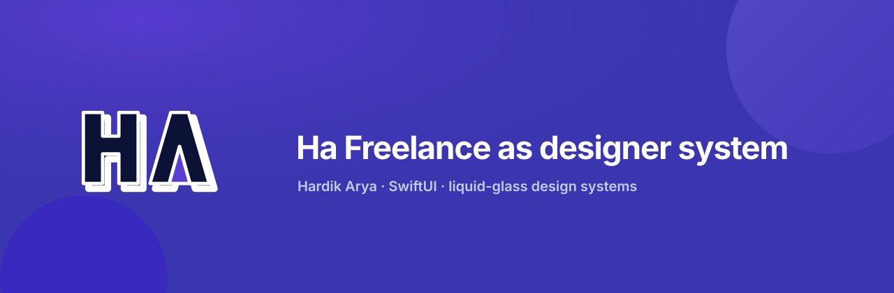

# Developer-GitHub- — Ha Freelance as designer system

My GitHub app, built in FreeMilk AI Code IDE: a dark, liquid-glass GitHub dashboard
plus a brand landing page for Hardik Arya. Plain HTML + Tailwind (CDN) + `app.js`,
with the whole 3D / glass design system in `styles.css`.

## Pages

- `main.html` — the main webpage: the HA lockup, what I build, featured
  repositories, the palette and a call to action.
- `index.html` — the dashboard: a GitHub-style left sidebar (Home, Feed, All issues,
  All pull requests, All repositories, Projects, Discussions, Codespaces, Copilot,
  Explore, Marketplace, MCP registry, and Top repositories), a profile tab bar
  (Overview / Repositories 10 / More), the Copilot prompt card with model and
  "Optimised for:" dropdowns, actions (Debbie, Agent, Create issue, Write code, Git),
  models, Top Repositories, Favorites, Shortcuts, the Feed section, the Code Analyst
  cards, plus Issues, Pull requests, Discussions, Projects, Repositories,
  Organisations, Starred, Feed, Codespaces, Explore, Marketplace, Packages, MCP
  registry, Inbox and Copilot pages.
- `signup.html` — sign-up screen (10px padding/margin throughout).
- `signin.html` — sign-in screen (10px padding/margin throughout).
- `styles.css` — palette, components and motion.
- `app.js` — routing with in/out page transitions, dropdowns, modals, scroll reveals,
  favourites (localStorage), prompt replies, code generators and the calculator /
  Pong / Mermaid demos.

## Logo and brand assets

- `favicon.png` / `apple-touch-icon.png` — the app icon: a glass-bubble Octocat on a
  deep blue-to-violet field, wired into `index.html` as the browser icon, home-screen
  icon and project icon.
- `assets/ha-logo.svg` — the HA monogram. Used for the in-app avatars, the message
  avatar, the right sidebar profile, the dashboard hero and the sign-in pages.
- `assets/ha-banner.svg` — the full lockup with the "Ha Freelance as designer
  system" wordmark, shown on `main.html`.

## Design

| Token | Value |
| --- | --- |
| Page background | `#3B35AF` |
| Home page surface | `#32288C` |
| Design light card | `#DBE7F5` |
| Message card | `#5A3DD3` |
| Gradient (buttons) | `#3100F6` → `#32288C` |

## Running it

No build step and no server are needed: `main.html` and `index.html` both sit at the
repository root. Open `index.html` in a browser, or use FreeMilk's preview link.
